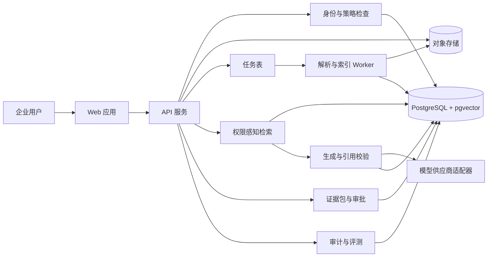
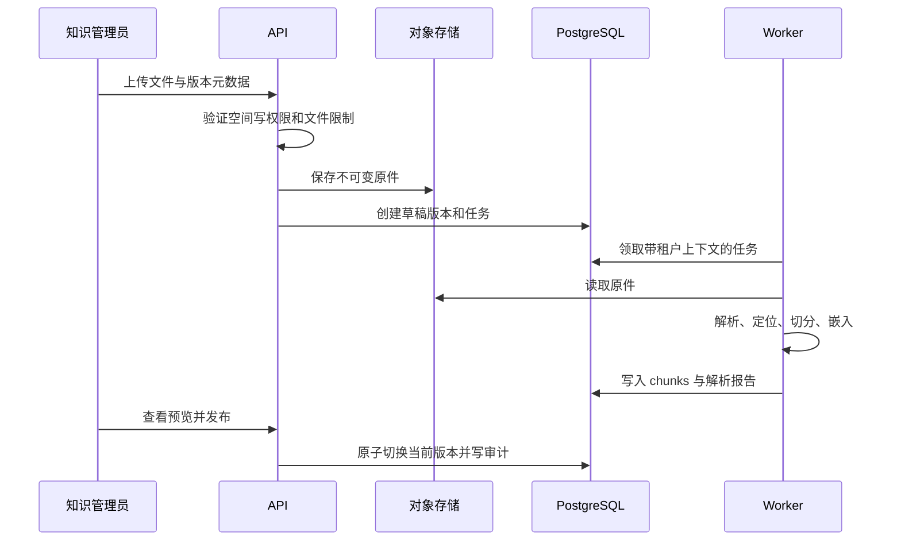

# MVP 系统架构

## 1. 架构目标

系统优先保证权限隔离、证据完整性和可追溯性，其次才是回答速度和措辞自然度。

关键不变量：

1. 未通过授权的内容不能进入检索候选集、模型上下文或日志。
2. 回答引用必须指向不可变的文档版本和稳定位置。
3. AI 输出、人工修改和最终决定不能互相覆盖。
4. 没有证据、证据过期或证据冲突时必须显式表达。
5. 模型和嵌入供应商可以替换，核心权限与证据模型不依赖供应商。

## 2. 逻辑架构



## 3. 组件职责

| 组件 | 责任 | 不负责 |
| --- | --- | --- |
| Web 应用 | 工作区、文档、问答、证据包和审批界面 | 直接访问数据库或模型密钥 |
| API 服务 | 身份验证、授权、业务规则、查询编排 | 执行耗时文档解析 |
| Worker | 解析、切分、嵌入、索引和重试 | 决定用户是否有权查看内容 |
| PostgreSQL | 业务记录、权限关系、全文索引、向量和审计元数据 | 保存大体积原始文件 |
| 对象存储 | 保存不可变原件和解析产物 | 作为权限判断的唯一来源 |
| 模型适配器 | 统一生成和嵌入调用、超时、成本与供应商元数据 | 绕过检索或读取数据库 |
| 引用校验器 | 检查事实性主张与引用、稳定定位和版本状态 | 判断高风险业务决定是否正确 |

## 4. 信任边界

### 4.1 浏览器边界

- 浏览器提供的 `tenant_id`、角色和文档标识都不可信。
- API 根据服务端会话重新计算当前用户和租户上下文。
- 对象下载使用短期授权地址或经 API 流式返回。

### 4.2 API 与数据库边界

- 应用层在每个用例执行显式授权。
- PostgreSQL 行级安全作为第二道防线。
- 应用数据库角色不能是表所有者、超级用户或拥有 `BYPASSRLS`。
- 后台任务必须携带受约束的租户上下文，不能运行无租户全表检索。

### 4.3 外部模型边界

- 只发送完成当前请求所需的最小授权片段。
- 不发送未引用的整份文档、权限列表或无关个人信息。
- 保存供应商、模型、请求模板版本和响应标识，但对敏感正文执行最小化记录。
- 企业策略可以禁止某一敏感等级调用外部模型。

## 5. 核心数据模型

| 实体 | 关键字段 |
| --- | --- |
| `tenants` | `id`, `name`, `status` |
| `users` | `id`, `external_subject`, `status` |
| `memberships` | `tenant_id`, `user_id`, `role` |
| `spaces` | `id`, `tenant_id`, `name`, `classification` |
| `space_memberships` | `space_id`, `user_id`, `role` |
| `documents` | `id`, `tenant_id`, `space_id`, `logical_key`, `title` |
| `document_versions` | `id`, `document_id`, `version`, `hash`, `valid_from`, `valid_until`, `status`, `object_key` |
| `chunks` | `id`, `document_version_id`, `locator`, `text`, `search_vector`, `embedding` |
| `document_grants` | `document_id`, `subject_type`, `subject_id`, `permission` |
| `questions` | `id`, `tenant_id`, `user_id`, `text`, `created_at` |
| `answers` | `id`, `question_id`, `status`, `model_run_id`, `answer_text` |
| `citations` | `answer_id`, `chunk_id`, `claim_key`, `quote`, `locator_snapshot` |
| `decision_packs` | `id`, `tenant_id`, `owner_id`, `status`, `version` |
| `decision_pack_revisions` | `decision_pack_id`, `content`, `actor_type`, `actor_id` |
| `approvals` | `decision_pack_id`, `reviewer_id`, `decision`, `comment`, `created_at` |
| `audit_events` | `tenant_id`, `actor_id`, `action`, `resource_type`, `resource_id`, `result`, `metadata` |
| `jobs` | `tenant_id`, `type`, `payload_ref`, `status`, `attempts`, `available_at` |

正文、模型输入和敏感元数据不应无差别复制到审计表。

## 6. 文档导入流程

当前实现使用 S3 兼容私有存储桶保存经应用层 AES-256-GCM 加密后的原件；本地开发可以切换为原子文件
后端。数据库中的 `object_key` 与供应商无关，便于在 AWS S3、R2、B2 和 MinIO 之间迁移。



解析与嵌入任务必须幂等；相同内容哈希和处理版本不重复生成结果。

## 7. 权限感知问答流程

1. API 从服务端会话得到 `user_id` 和 `tenant_id`。
2. 策略层计算可访问空间、文档和版本。
3. SQL 查询在租户、授权、发布状态和有效期条件下执行全文与向量检索。
4. 检索器合并候选结果，保留文档版本和定位信息。
5. 风险分析器标记冲突、过期和证据缺口。
6. 模型适配器只接收允许的候选片段和结构化输出要求。
7. 引用校验器验证引用属于本次候选集，且引文与原始片段匹配。
8. 如果事实性主张缺少引用，系统删除该主张、降低状态或拒答。
9. 系统保存回答、引用、策略版本和必要审计元数据。

禁止“先对全库向量检索，再在应用层丢弃越权结果”的实现。

## 8. 检索策略

P0 使用 PostgreSQL 全文检索与 pgvector 组成混合检索：

- 关键词检索处理政策编号、术语、姓名和精确短语。
- 向量检索处理同义表达和自然语言问题。
- `tenant_id`、`space_id`、文档授权、版本状态和有效期是检索前置条件。
- 数据规模较小时优先精确向量检索；确认性能瓶颈后才启用 HNSW。
- 启用近似索引后必须单独评估权限过滤后的召回率。

## 9. API 边界草案

```text
POST   /v1/spaces
POST   /v1/spaces/{space_id}/members
POST   /v1/documents
POST   /v1/documents/{document_id}/versions
POST   /v1/document-versions/{version_id}/publish
GET    /v1/document-versions/{version_id}/status
POST   /v1/questions
GET    /v1/answers/{answer_id}
POST   /v1/answers/{answer_id}/decision-packs
POST   /v1/decision-packs/{pack_id}/submit
POST   /v1/decision-packs/{pack_id}/reviews
GET    /v1/audit-events
```

所有资源标识都必须在当前租户和权限上下文中解析，不能只凭全局 ID 查询。

## 10. 审计、可观测性与评测

- 每次请求生成关联 ID，贯穿 Web、API、Worker、数据库操作和模型调用。
- 记录延迟、错误类型、检索候选数、引用覆盖率、拒答原因和模型用量。
- 日志中不记录访问令牌、模型密钥、完整文档正文或默认完整提示词。
- 评测集与生产内容分离，但使用同一权限和检索路径。
- 发布门禁至少包含：租户隔离、角色权限、引用完整性、不可回答、冲突和过期测试。

## 11. MVP 部署形态

- 单区域部署 Web、API 和一个 Worker。
- 一个 PostgreSQL 实例和一个 S3 兼容对象存储。
- 使用数据库任务表，暂不引入独立消息队列。
- 本地开发通过 Docker Compose 启动依赖服务。
- 测试环境使用独立数据库、对象存储桶和模型凭据。

## 12. 建议的仓库结构

```text
apps/
  web/                 # Next.js Web 应用
services/
  api/                 # FastAPI API
  worker/              # 文档处理与索引 Worker
packages/
  contracts/           # OpenAPI 生成物或共享契约
  evals/               # 评测集结构与运行器
infra/
  docker/              # 本地依赖服务
docs/
  decisions/           # ADR
```

## 13. 后续架构决策

- 身份提供商和企业 SSO 路径。
- 初始生成模型与嵌入模型。
- 文档解析库及复杂 PDF 的降级策略。
- 敏感信息识别与脱敏策略。
- 数据保留、删除和备份恢复要求。

